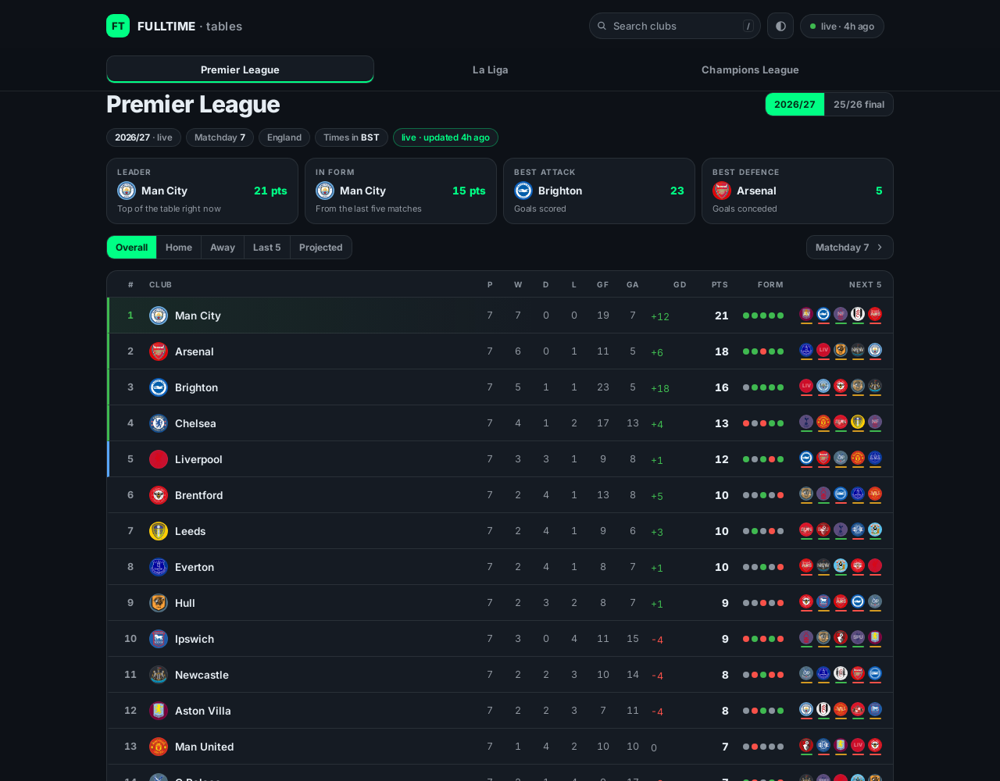

# FULLTIME

League tables for the **Premier League**, **La Liga** and the **UEFA Champions
League** — standings, every club's full season, and round-by-round results.

Live: https://lazizbekravshanov.github.io/fulltime/



*Screenshots are taken from the published site by `.github/workflows/live-check.yml`,
which drives it in a real browser and reports what it renders.*

## What it does

**Tables.** Overall standings come straight from the competition's own table,
so the tiebreaks are the real ones. Home, Away, Last 5 and Projected are
recomputed in the browser from the fixture list, and each row marks how far the
club has moved against the real table. Projected carries points-per-game across
every remaining fixture and shows the current total beside it.

Any stat heading sorts the table: once for highest first, again for lowest, a
third time to hand the order back to the competition. Position, the
qualification stripe and the movement arrows keep describing the real table
while you do, because you are looking at the same table from a different angle
rather than a different table. Goals for and against get columns of their own
on a wide enough window.

**Next five.** Every row carries its next five opponents as crests, underlined
by how high that opponent currently sits — a fixture-difficulty read at a
glance. A hollow bar means away.

**Matchdays.** Every match in a round, league-wide, with prev/next and a jump
back to the round the competition is actually on. Beside the list: the round's
goals and goals per match, its home/draw/away split, the widest margin, and the
clubs that moved — worked out by standing the table up at this round and at the
one before it.

**Match pages.** Tap any match for the scoreline, every goal with its scorer and
minute (penalties and own goals marked), live text commentary while it is being
played, and the head-to-head record between the two clubs. Scorers come from the
snapshot and are always there; commentary is read from `commentary.json`, asked
for the moment you open a match and refreshed every minute while the match is in
play, every five otherwise.

**Clubs.** Tap any club for its whole season: every match in date order grouped
by month, results and kick-offs, home/away splits, form, and a season-shape
chart of its position after each matchday. Alongside, following you down the
page: the next match with the opponent's standing and kick-off, and the club's
own neighbourhood in the table with the points gap either way. Clubs in two
competitions can merge both schedules into one chronological season. Any club's
fixtures export as an `.ics` calendar, generated in the browser.

**Season records.** Longest current unbeaten run, longest winless run, biggest
win and most clean sheets, per competition.

**Top performers.** Goals, assists, shots on target, accurate passes, saves and
yellow cards — the top eight in each, per competition, switchable in place.

**Live scores.** Matches in play carry a running score and a LIVE badge, on the
table, the matchday list and the club's season. These come from the committed
file, and from a direct call the page makes to TheSportsDB — which that host
began refusing on CORS grounds in October 2026, so scores during a match are
currently as fresh as the last committed refresh and no fresher. See *It updates
itself* below.

**Yours.** Star a club and it pins above its table and becomes the landing
view. Search filters as you type (`/` focuses it, Enter opens the top hit).
Light and dark both first-class, following the system preference until you
choose. Installable to a phone home screen — but no service worker, because
stale standings are worse than no offline mode.

Kick-offs are stored in UTC and rendered in your own time zone, which the page
names so you know what you're reading.

## It updates itself

Two layers, so the page is never showing yesterday's table.

A browser cannot read ESPN directly. It answers `curl` with
`Access-Control-Allow-Origin: *` but sends no such header to a real `fetch`, so
every cross-origin request from the page is blocked. Anything that comes from
ESPN is therefore pulled by scheduled jobs, which have no such restriction, and
committed here.

The page also tries TheSportsDB directly, on every load, for the scores of
matches in play — the one thing a file committed hours ago cannot carry. That
worked when it was written, in September 2026, because TheSportsDB did send the
header ESPN withholds.

**It does not any more.** As of 23 October 2026 the browser blocks those two
calls for the same reason it blocks ESPN, and `.github/probe/live-check.json`
records it from a real browser on the real origin. Nothing breaks: `pullSources`
treats a reply it could not read as no reply, the committed files carry the page
on their own, and the status pill reports their real age. But in-play scores are
not currently reaching anybody, and the code that fetches them is, for now,
doing nothing.

So a visitor's browser talks to this repository's Pages origin, and
`raw.githubusercontent.com` for a possibly fresher copy of the same files. It
attempts `thesportsdb.com` and is refused.

`update-live.mjs` writes two files. `live.json` is small
— the current table, today's scores and goal scorers — and the page fetches it
after first paint, applies it on top of the snapshot, and polls it once a minute
while a match is in play. A finished match is written into the fixture list, so
the splits, records and season-shape chart all move with it. `commentary.json`
holds the text commentary for the matches in play or just finished; it is bulky,
so it is fetched only when you open a match, never on the way to a table.

`update-standings.mjs` writes `data.json`: standings, the full season of
fixtures, each match's goal scorers and the competition leader boards. That is
what gives the page its instant first paint and something to show when nothing
else can be reached. It also writes `athletes.json`, a name cache that only the
next run reads — keeping it out of the snapshot saves every visitor the
download. The 2025/26 final tables are not in either file; they are a verified
constant in `index.html`, so they are there even when nothing loads.

Before replacing the snapshot, the job counts what each competition can do —
rows, fixtures, results, event ids, scorer sets, leader boards — compares that
against the file it is about to overwrite, and refuses to trade a capability for
its absence. This exists because it had to: ESPN retired a request format in
September 2026 and the job spent 29 days reporting success while shipping a
snapshot with no goal scorers, no match pages and no Champions League fixtures
at all. Losing something outright now fails the run and leaves the committed
snapshot untouched; losing more than half of it warns.

Both files are asked for with a per-minute token, because GitHub caches them for
ten minutes. The season rolls over automatically each August.

**How often that actually happens.** The crons ask for every five minutes and
every hour. GitHub does not oblige: scheduled workflows on a quiet public
repository are throttled hard, and measured over 98 and 88 scheduled runs the
median gap between them was 292 and 334 minutes — roughly five hours, never
faster than two. So treat the committed files as a few hours old. The status
pill beside the search box reports the real age rather than the intended one,
and says which half of the page is stale when the two jobs disagree.

Sources: ESPN's public feed for standings, crests, kick-off instants, goal
scorers, commentary, competition leaders and Champions League fixtures;
[openfootball](https://github.com/openfootball/football.json) open data for
domestic fixtures and matchday numbers; and TheSportsDB, attempted by the page
itself for scores during a match, currently blocked. Where ESPN and openfootball
disagree on a club's name, fixtures are re-keyed onto the name the table shows;
where they disagree on a result, ESPN wins, because openfootball posts scores
about a week late.

## Files

- `index.html` — the entire site (vanilla HTML/CSS/JS, no build step), and the
  2025/26 final tables it falls back to
- `data.json` — the slow snapshot: standings, fixtures, goal scorers, leaders
- `live.json` — the fast file: table, today's scores, scorers
- `commentary.json` — text commentary, fetched only when a match is opened
- `athletes.json` — a name cache for the updater; the page never reads it
- `scripts/update-standings.mjs` — the snapshot updater (Node 18+, zero dependencies)
- `scripts/update-live.mjs` — the live updater, sharing its helpers
- `scripts/*.test.cjs` — unit tests, run by CI before every refresh
- `.github/scripts/live-check.mjs` — drives the published site in a real browser
  and refreshes the screenshots above
- `.github/scripts/espn-probe.mjs` — asks ESPN which of its endpoints still
  answer, and commits the reply to `.github/probe/espn.json`
- `manifest.webmanifest`, `icon*.png`, `icon.svg` — home-screen install
- `vercel.json` — config if you'd rather host it on Vercel

### The shape of `data.json`

Each competition under `comps` carries `rows` (the standings), `leaders`,
`events`, and its fixtures packed against three intern tables:

```js
{
  clubs:   ["Arsenal", "Aston Villa", ...],        // index space for matches
  dates:   ["2026-08-21", ...],
  times:   ["19:00Z", ...],                        // UTC, trailing Z
  matches: [[matchday, dateIdx, timeIdx, homeIdx, awayIdx, homeGoals, awayGoals, eventId]]
}
```

Every match appears **once**, from the home side's point of view; the page
expands them back into per-club fixture lists on load. A fixture still to be
played carries null goals but keeps its event id, because ESPN publishes that
with the schedule — `[8, 23, 0, 9, 18, null, null, "401879253"]`. Any nulls
genuinely left trailing are dropped, which in practice only happens for a match
the scoreboard has not named yet.

Two fields the snapshot no longer carries, because they can be worked out: a
row's crest URL is `https://a.espncdn.com/i/teamlogos/soccer/500/<row.id>.png`,
and its goal difference is `gf - ga`.

`eventId` keys into `comps.<league>.events`, where a match's goals are
`[minute, scorer, home?1:0, kind]` with kind `""`, `"p"` for a penalty or `"o"`
for an own goal.

Snapshots written before October 2026 used a `fixtures` map keyed by club, with
each match stored twice. The page still reads that shape, because a CDN can hand
a visitor a stale copy for ten minutes after a deploy.

## Run it locally

```sh
python3 -m http.server 8000   # then open http://localhost:8000
node scripts/update-standings.mjs   # refresh data.json by hand
node scripts/update-live.mjs        # refresh live.json by hand

node scripts/scorers.test.cjs       # the scorer parser
node scripts/guard.test.cjs         # the snapshot regression guard
node scripts/round.test.cjs         # which round counts as current
```
